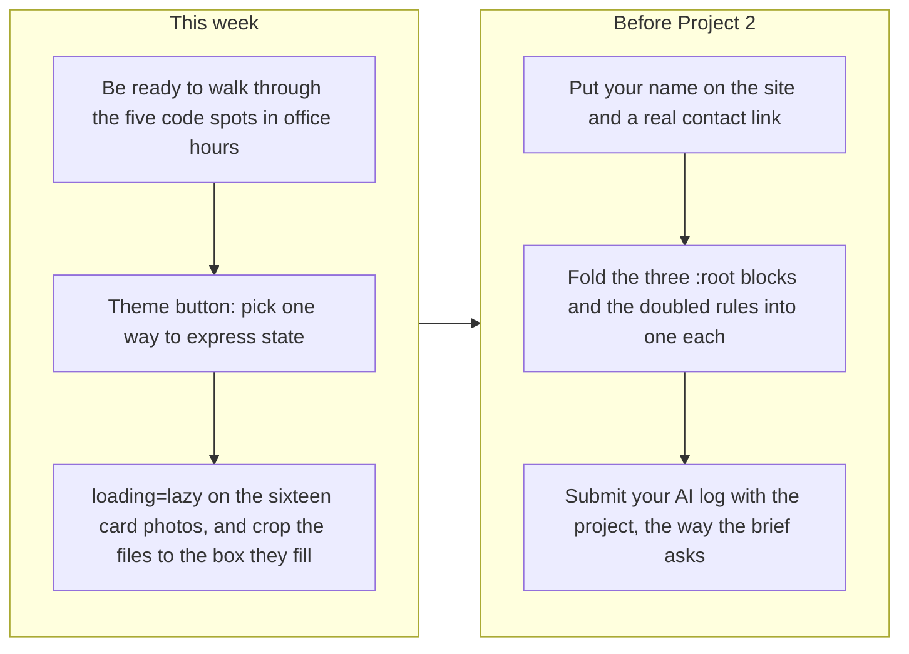

# Project 1: Static Foundations. Feedback for Anthony

**Student:** Anthony (GitHub `Anthonydosse777`) · **Course:** CSC 436, Fall 2026 · **Reviewed at commit:** [`ff1daf7`](https://github.com/Anthonydosse777/csc436_Project1/commit/ff1daf7fceb684bb9b2063b73cee8a4214551f39)
**Repo:** https://github.com/Anthonydosse777/csc436_Project1 · **Live:** https://gainsforyou.netlify.app/

> **How this review was made.** Your instructor reviewed this project with Claude (Anthropic's AI) as a second set of eyes. Claude cloned the repo, read both pages, both scripts and the 2,530-line stylesheet, ran the W3C validator on both pages, loaded the live site at 320, 375, 768 and 1280 pixels, and exercised all seven interactions with known inputs: the level picker, the theme toggle across pages and reloads, the protein calculator in both units, the diet filter, the checklist and its reset, and the scroll reveal on a short phone with the longest cards open. It diffed the live site against the repo and read all twenty commits. Every note and every point below was read and approved by your instructor. Same rubric, same standard, just more time spent looking at your code than one person has in a grading week.

## Grade: 95 / 100

| Category | Points | Earned | One line |
|---|---|---|---|
| Semantic HTML | 20 | **19** | Zero validator messages on both pages, skip link, labelled navs and sections, `dl`, `ol`, `details`, `figure`, a real form with `fieldset`, `output` and `progress`; the theme button says its state twice |
| CSS layout | 25 | **24** | 56 tokens used 372 times, 16 Flexbox and 10 Grid containers, intrinsic `auto-fit` grids, mobile-first with no max-width query anywhere; the file was grown by appending, so core rules exist two and three times |
| Responsive design | 15 | **15** | No horizontal scroll at 320, 375, 768 or 1280 on either page; every layout changes with width |
| JavaScript interaction | 15 | **15** | Seven interactions, all verified with known inputs, all with accessible state, storage wrapped in try/catch, motion and pointer guards |
| Repository and deployment | 15 | **14** | README is the most complete in the class, twenty well-described commits across five days, deploy matches repo; a tool's worktree reference was committed and had to be removed |
| Content and polish | 10 | **8** | Real coaching content, seventeen licensed photographs with descriptive alt text, two themes; no lazy loading, oversized portrait files cropped into small boxes, a placeholder contact address and no author name |
| **Total** | **100** | **95** | The highest score in the class. Nothing here is broken. What is left is three small edits and one conversation. |

## The short version

Everything on this site works, and I tried to break it. Both pages validate with zero messages. There is no horizontal scroll at 320 pixels, which is narrower than the brief asks for and which your README claims; the claim is true. The level picker shows 0, then 16, then 32 tips and never hides a card. The calculator turns 70 kg into 112 to 154 g and 160 lb into 116 to 160 g, re-ranges the input when the unit changes, and refuses a weight of 5. The diet filter shows 12, 8 and 4 foods. The checklist survives a reload and resets. The theme survives a reload and follows you to the second page. The scroll reveal fires for every section on a 375 by 667 phone with the longest cards open, and there is a `noscript` rule so the page is never blank without JavaScript. Zero console errors anywhere.

The five points that came off are small and real. The theme button changes its label and its `aria-pressed` at the same time, so a screen reader hears a contradiction. The stylesheet was extended by adding new layers at the bottom instead of editing the rules above, so `:root` exists three times and `.card`, `.reveal` and `.site-header` twice each. None of the seventeen photographs lazy-load on a page well over 10,000 pixels tall on a phone, and the files are 1000 by 1500 portraits cropped into 400 by 260 boxes. The contact link is `hello@gymstarterguide.example`, and your name is nowhere on the site. And a tool's worktree folder was committed and then removed.

One more thing, said plainly and without accusation. The brief allows AI and asks two things in return: that you submit your AI log, and that you can explain every line. The repo shows this was built with Claude Code, which is fine. No log came in with the submission, so the explanation is the check. The five spots to prepare are listed near the end.

## What the numbers looked like

| Check | Result |
|---|---|
| W3C HTML validator | 0 errors, 0 warnings, 0 info, on both pages |
| Horizontal scroll at 320 / 375 / 768 / 1280 | None, on both pages |
| Heading order | h1 > h2 > h3 > h4, no skipped levels, one h1 per page |
| Semantic elements, home page | skip link, header, 2 labelled nav (ul), main, 8 section (8 of 8 with aria-labelledby), 16 article, dl, ol, 5 details, footer |
| Semantic elements, nutrition page | form with label, 2 fieldset and legend, output, progress, figure with figcaption |
| Media queries | 17: 11 min-width (40em, 64em, 80em), 0 max-width, 4 prefers-reduced-motion, 1 coarse-pointer guard |
| Layout | 16 `display: flex`, 10 `display: grid`, 12 `auto-fit` or `auto-fill` |
| Custom properties | 56 defined, 372 uses |
| Classes defined in CSS but unused | 0 |
| `!important` | 13, all inside reduced-motion and coarse-pointer blocks |
| Level picker: Beginner / Intermediate / Advanced | 0 / 16 / 32 tips visible; 16 of 16 cards visible at every level; aria-pressed moves; live status updates |
| Theme toggle | Background `rgb(10,10,11)` to white, stored, restored on reload, carried to the second page |
| Calculator: 70 kg | 112–154 g a day, about 28–39 g at each of 4 meals |
| Calculator: 160, then switch to lb | 116–160 g a day; input limits become 66 to 550 |
| Calculator: weight 5 | Rejected by `checkValidity`, result unchanged |
| Diet filter: All / Vegetarian / Plant-based | 12 / 8 / 4 cards, status line matches |
| Checklist | 2 of 6 ticked, progress element 2, saved with today's date, still ticked after reload, reset clears all |
| Scroll reveal at 375×667 and 320×568, Advanced open | 6 of 6 sections revealed; tallest section 3,613 px |
| Console errors | 0 |
| Images | 17 JPEGs, 1.86 MB total, all 1000 px wide (most 1000×1500), drawn in 400×260 boxes; 0 with `loading="lazy"`, 0 with `srcset` |
| Commits | 20 across Sep 4, 5, 6, 11 and 13; every message says what changed |
| README | Title, description, run locally, live URL, file table, how each rubric item is met, accessibility notes |
| Live vs repo | CSS and JS identical; HTML identical apart from Netlify rewriting `.html` links |

---

## Semantic HTML: 19 / 20

### What's working

- **The validator has nothing to say about either page**, which no other two-page site in the class managed. A skip link is the first tab stop ([index.html#L23](https://github.com/Anthonydosse777/csc436_Project1/blob/ff1daf7fceb684bb9b2063b73cee8a4214551f39/index.html#L23)). Two navs, each with an `aria-label` and a list ([#L32](https://github.com/Anthonydosse777/csc436_Project1/blob/ff1daf7fceb684bb9b2063b73cee8a4214551f39/index.html#L32)). All eight sections carry `aria-labelledby`. Exercises are `article`s, the muscle and difficulty labels are a `dl` ([#L109](https://github.com/Anthonydosse777/csc436_Project1/blob/ff1daf7fceb684bb9b2063b73cee8a4214551f39/index.html#L109)), the steps are an `ol` because order matters ([#L113](https://github.com/Anthonydosse777/csc436_Project1/blob/ff1daf7fceb684bb9b2063b73cee8a4214551f39/index.html#L113)), and the FAQ is native `details`.
- **The nutrition page uses the elements most students never reach for.** A real `form` with a `label`, a `fieldset` and `legend` for the unit, an `output` tied to the input with `for` ([nutrition.html#L156-L175](https://github.com/Anthonydosse777/csc436_Project1/blob/ff1daf7fceb684bb9b2063b73cee8a4214551f39/nutrition.html#L156-L175)), a native `progress` for the checklist, and a `figure` with `figcaption` for the plate. The status line is `role="status"` with `aria-live="polite"` ([index.html#L88](https://github.com/Anthonydosse777/csc436_Project1/blob/ff1daf7fceb684bb9b2063b73cee8a4214551f39/index.html#L88)).
- Every one of the seventeen images has alt text that describes the photograph, not just the exercise name.

### What to change

- **The theme button expresses its state twice, and the two disagree** ([index.html#L44-L46](https://github.com/Anthonydosse777/csc436_Project1/blob/ff1daf7fceb684bb9b2063b73cee8a4214551f39/index.html#L44-L46), [script.js#L116-L125](https://github.com/Anthonydosse777/csc436_Project1/blob/ff1daf7fceb684bb9b2063b73cee8a4214551f39/script.js#L116-L125)). On the dark page it reads "White background" with `aria-pressed="false"`. Click it and it reads "Black background" with `aria-pressed="true"`. A screen reader announces "Black background, toggle button, pressed" while the page is white. A toggle button should either keep one label and let `aria-pressed` carry the state, or change its label and have no `aria-pressed` at all. Pick one.

  ```mermaid
  flowchart TB
    A["The theme button today: the label flips AND aria-pressed flips"]
    A --> B["Dark page. Label: White background. aria-pressed: false"]
    A --> C["Light page. Label: Black background. aria-pressed: true"]
    C --> D["A screen reader says: Black background, toggle button, pressed. So is black on? It is not. The page is white."]
    D --> E["Fix A: one fixed label, White background, and let aria-pressed carry the state"]
    D --> F["Fix B: keep the changing label as an action, and remove aria-pressed"]
  ```

## CSS layout: 24 / 25

### What's working

- **A real token system, actually used.** 56 custom properties, 372 `var()` references, and a light theme that is nothing but a second set of values under `:root[data-theme="light"]` ([styles.css#L15](https://github.com/Anthonydosse777/csc436_Project1/blob/ff1daf7fceb684bb9b2063b73cee8a4214551f39/styles.css#L15), [#L43](https://github.com/Anthonydosse777/csc436_Project1/blob/ff1daf7fceb684bb9b2063b73cee8a4214551f39/styles.css#L43)). Not one class in the stylesheet is unused.
- **Flexbox and Grid each doing the job they are for.** Flex for the header shell, nav row, filter bars and card interiors; Grid for the galleries, the calculator beside its result, the plate beside its legend. Twelve of the grids are intrinsic. The food cards use `auto-fill` instead of `auto-fit` on purpose, so the filtered list of four keeps its card size instead of stretching across the row ([styles.css#L2097-L2111](https://github.com/Anthonydosse777/csc436_Project1/blob/ff1daf7fceb684bb9b2063b73cee8a4214551f39/styles.css#L2097-L2111)). That is a distinction most working developers cannot explain.
- **Mobile-first, strictly.** Eleven `min-width` queries, zero `max-width`. Four reduced-motion blocks and a coarse-pointer guard that zeroes the 3D tilt on touch screens ([#L1609](https://github.com/Anthonydosse777/csc436_Project1/blob/ff1daf7fceb684bb9b2063b73cee8a4214551f39/styles.css#L1609)). All thirteen `!important`s live inside those safety blocks, which is where they belong. `:focus-visible` outlines throughout.

### What to change

- **The file was grown by appending, not editing.** `:root` is declared at lines [15](https://github.com/Anthonydosse777/csc436_Project1/blob/ff1daf7fceb684bb9b2063b73cee8a4214551f39/styles.css#L15), [1103](https://github.com/Anthonydosse777/csc436_Project1/blob/ff1daf7fceb684bb9b2063b73cee8a4214551f39/styles.css#L1103) and [1671](https://github.com/Anthonydosse777/csc436_Project1/blob/ff1daf7fceb684bb9b2063b73cee8a4214551f39/styles.css#L1671), and the light theme three times to match. `.card` is at [409](https://github.com/Anthonydosse777/csc436_Project1/blob/ff1daf7fceb684bb9b2063b73cee8a4214551f39/styles.css#L409) and again at [1326](https://github.com/Anthonydosse777/csc436_Project1/blob/ff1daf7fceb684bb9b2063b73cee8a4214551f39/styles.css#L1326); `.reveal` at [1000](https://github.com/Anthonydosse777/csc436_Project1/blob/ff1daf7fceb684bb9b2063b73cee8a4214551f39/styles.css#L1000) and [1590](https://github.com/Anthonydosse777/csc436_Project1/blob/ff1daf7fceb684bb9b2063b73cee8a4214551f39/styles.css#L1590); `.site-header` at 185 and 1247. Each later block overrides part of the earlier one. It works, because the cascade is doing what it is told, but to know what a card looks like you now have to read two rules 900 lines apart and merge them in your head. This is what a stylesheet looks like when each new feature is added as a new layer at the bottom. Fold each pair into one rule and the file loses several hundred lines without changing a pixel.

## Responsive design: 15 / 15

### What's working

- No horizontal scroll at 320, 375, 768 or 1280 on either page, measured in real viewports. The header stacks on a phone and becomes a single row at 80em. The galleries reflow on their own. The workout timeline is vertical on a phone and horizontal on a desktop. Your README says it was checked at 320; Claude checked it at 320 too, and the README is right. Full marks.

## JavaScript interaction: 15 / 15

### What's working

- **Seven interactions, each one finished.** Every one selects, listens and changes the page, and every one was tested with inputs whose answers Claude worked out in advance. The level picker uses `hidden` and `dataset`, moves `aria-pressed`, and hides the empty "Taking it further" heading so beginners never see it ([script.js#L57-L79](https://github.com/Anthonydosse777/csc436_Project1/blob/ff1daf7fceb684bb9b2063b73cee8a4214551f39/script.js#L57-L79)). The calculator reads `valueAsNumber`, defers to the browser's own validation, and swaps the input's `min` and `max` when the unit changes so that validation is always checking the right range ([nutrition.js#L49-L58](https://github.com/Anthonydosse777/csc436_Project1/blob/ff1daf7fceb684bb9b2063b73cee8a4214551f39/nutrition.js#L49-L58), [#L80-L89](https://github.com/Anthonydosse777/csc436_Project1/blob/ff1daf7fceb684bb9b2063b73cee8a4214551f39/nutrition.js#L80-L89)). The checklist stores the date with the ticks so it clears itself at the visitor's own midnight ([#L185-L196](https://github.com/Anthonydosse777/csc436_Project1/blob/ff1daf7fceb684bb9b2063b73cee8a4214551f39/nutrition.js#L185-L196)).
- **The defensive details are the impressive part.** Every `localStorage` call is in a try/catch. The reveal falls back to showing everything if the API is missing or the visitor prefers reduced motion ([script.js#L162-L187](https://github.com/Anthonydosse777/csc436_Project1/blob/ff1daf7fceb684bb9b2063b73cee8a4214551f39/script.js#L162-L187)), and a `noscript` style makes the page visible with JavaScript off ([index.html#L14-L18](https://github.com/Anthonydosse777/csc436_Project1/blob/ff1daf7fceb684bb9b2063b73cee8a4214551f39/index.html#L14-L18)). The tilt is throttled to one update per frame, reads layout inside the frame, and cancels its queued frame on the way out so a card is never left crooked ([#L225-L264](https://github.com/Anthonydosse777/csc436_Project1/blob/ff1daf7fceb684bb9b2063b73cee8a4214551f39/script.js#L225-L264)).
- Claude specifically tried to break the reveal: a 375 by 667 phone, Advanced selected so every card is at its tallest, sections up to 3,613 pixels high against an 8 percent threshold. All six sections revealed.

### What to change

- Nothing that costs points. One consistency note: `statusMessage` is guarded for the page that lacks a level picker, but `themeButton.addEventListener` on [line 137](https://github.com/Anthonydosse777/csc436_Project1/blob/ff1daf7fceb684bb9b2063b73cee8a4214551f39/script.js#L137) is not guarded at all. Both pages have the button today. The first page that does not will throw there and take the reveal and the tilt down with it.

## Repository and deployment: 14 / 15

### What's working

- **The README is the best in the class.** Title, description, two ways to run it, the live link, a file table, a section mapping each rubric requirement to where it is met, and accessibility notes ([README.md](https://github.com/Anthonydosse777/csc436_Project1/blob/ff1daf7fceb684bb9b2063b73cee8a4214551f39/README.md)). Every claim in it that Claude could test turned out to be true.
- **Twenty commits on five separate days**, Sep 4 to Sep 13, all before the deadline, each with a message that says what changed. The history also shows the design changing its mind: a muscle-group filter became a difficulty filter, and then became tips that never hide a card, with a comment in the script explaining why. The live site matches the repo, and `.gitignore` is thorough.

  ```mermaid
  flowchart TB
    d1["Sep 4, 06:37 to 06:49. Eight commits in twelve minutes: scaffold, structure, SVG art, sixteen cards, base styles, media queries, a filter, README. About 1,500 lines."]
    d2["Sep 4, 11:48 to 11:56. Three commits, two in the same second: a full rewrite with real content, a new layout, new interactions."]
    d3["Sep 5, 17:30 to 17:35. Photographs replace the illustrations, hover and scroll reveal, the black and gold palette, README rewritten."]
    d4["Sep 6. Live URL added."]
    d5["Sep 11. Nutrition page, tips replace the difficulty filter, 3D cards. 2,719 lines in one commit."]
    d6["Sep 13. Next-page links. A stray .claude worktree reference removed."]
    d1 --> d2 --> d3 --> d4 --> d5 --> d6
  ```

### What to change

- **A tool's working folder was committed** and then removed in the final commit ([`ff1daf7`](https://github.com/Anthonydosse777/csc436_Project1/commit/ff1daf7fceb684bb9b2063b73cee8a4214551f39)): a `.claude/worktrees/` reference that git recorded as a submodule. You caught it and added the ignore rule, which is the right fix. The lesson is to look at `git status` before each commit rather than committing everything in the folder.
- A note, not a deduction: eight commits and about 1,500 lines in twelve minutes, and two commits in the same second, is not the pace of typing. The history is a faithful record of how the work was split up. It is not by itself evidence of what you understand, which is why the next section exists.

## Content and polish: 8 / 10

### What's working

- The content is real and it is good. Sixteen exercises with coaching cues a beginner could follow, progressive-overload notes that know which lifts not to keep loading, nutrition numbers with their basis stated, and an opening line ("No supplements. No transformation photos.") that gives the site a point of view. Seventeen licensed photographs, a consistent black and gold identity, a working light theme, a favicon.

### What to change

- **Nothing lazy-loads, and the files are bigger than their boxes** ([index.html#L105](https://github.com/Anthonydosse777/csc436_Project1/blob/ff1daf7fceb684bb9b2063b73cee8a4214551f39/index.html#L105)). All seventeen images are requested up front on a page that is well over 10,000 pixels tall on a phone; sixteen of them are below the fold. Add `loading="lazy"` to every card image. Then look at the files: most are 1000 by 1500 portraits, drawn into a 400 by 260 landscape box, so about four fifths of every download is cropped away. Crop them to 800 by 520 and the 1.86 MB becomes roughly a third of that. The `width="400" height="260"` attributes should also describe the file you actually ship.
- **The contact link goes nowhere, and the site is unsigned** ([index.html#L709](https://github.com/Anthonydosse777/csc436_Project1/blob/ff1daf7fceb684bb9b2063b73cee8a4214551f39/index.html#L709)). `hello@gymstarterguide.example` is a placeholder domain. There is no author name in the footer, the head, or anywhere else on either page. Put your name on your work and link something real.

## On the "explain every line" rule

The brief allows AI, asks you to submit your AI log, and requires that you can explain every line you hand in. The `.claude/` entries and the commit pace show this was built with Claude Code. That is allowed, and nobody is accusing you of anything. No log arrived with the submission, so please send it, and come to office hours ready to walk through these five in your own words:

1. **The frame throttle** ([script.js#L223-L252](https://github.com/Anthonydosse777/csc436_Project1/blob/ff1daf7fceb684bb9b2063b73cee8a4214551f39/script.js#L223-L252)). What does `if (pendingFrame !== null) return` prevent? Why is `getBoundingClientRect` called inside the frame and not in the event handler? Why is `rotateX` negated and `rotateY` not?
2. **The exit** ([script.js#L257-L264](https://github.com/Anthonydosse777/csc436_Project1/blob/ff1daf7fceb684bb9b2063b73cee8a4214551f39/script.js#L257-L264)). What goes wrong if you delete the `cancelAnimationFrame` call? Why does removing the inline property flatten the card instead of setting it to zero?
3. **The unit switch** ([nutrition.js#L80-L89](https://github.com/Anthonydosse777/csc436_Project1/blob/ff1daf7fceb684bb9b2063b73cee8a4214551f39/nutrition.js#L80-L89)). A visitor types 160 while "kg" is selected, then picks "lb". Walk through every line that runs and what the page shows at each step.
4. **The date** ([nutrition.js#L185-L196](https://github.com/Anthonydosse777/csc436_Project1/blob/ff1daf7fceb684bb9b2063b73cee8a4214551f39/nutrition.js#L185-L196)). Why `'en-CA'`? What would break with `toISOString()` for a visitor in New York at 9 PM? Why is `JSON.parse` inside the try?
5. **`auto-fit` versus `auto-fill`** ([styles.css#L2097-L2111](https://github.com/Anthonydosse777/csc436_Project1/blob/ff1daf7fceb684bb9b2063b73cee8a4214551f39/styles.css#L2097-L2111)). Show what the plant-based filter would look like with `auto-fit`, and explain why.

If those come easily, this is a 95 that was earned, and it is the best project in the class.

---

## Your next three moves



1. **Prepare the five explanations and send the AI log.** It is the only item on this list that is not a code edit, and it is the one that matters.
2. **Fix the theme button and the images.** One attribute removed or one label fixed; `loading="lazy"` sixteen times; seventeen files cropped.
3. **Sign the site and consolidate the stylesheet.** Your name, a real link, and one `:root` instead of three.

*This review lives in a pull request on your repo. It only adds files under `feedback/` and does not touch your code. Merge it, close it, or just read it. Questions go to office hours or the Brightspace board. This is excellent work, Anthony. Come show us you own it.*
